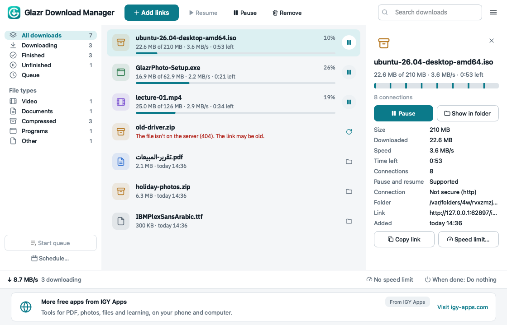
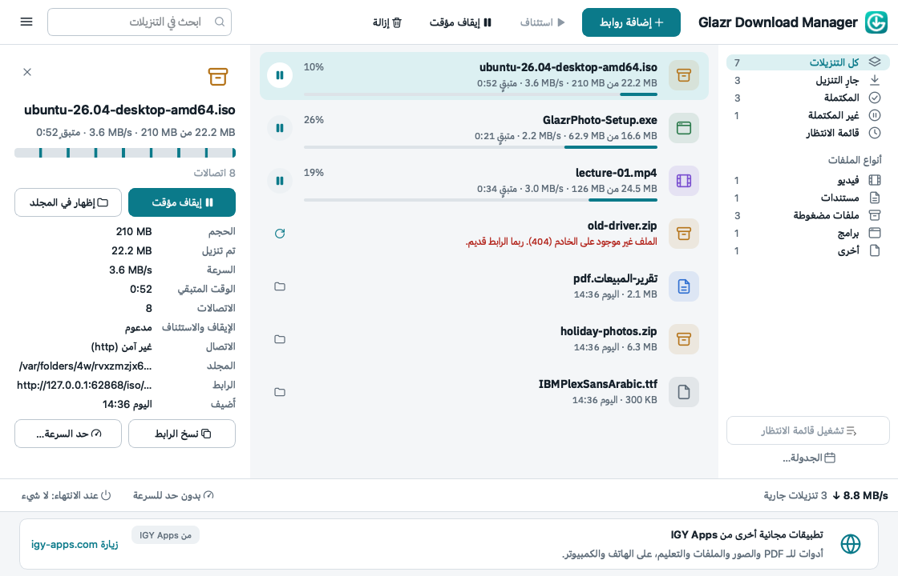

# Glazr Download Manager

Free download manager for **Windows 10/11** and **macOS** by [IGY Apps](https://igy-apps.com).
Faster downloads with several connections per file, pause and resume that survive restarts
and dropped connections, a queue with a schedule, and speed limits.

- Several connections per file, split while it downloads.
- Pause and resume any time, even after a restart or a power cut.
- Queue, schedule, speed limits; sleep or shut down when done.
- Browser extension for Chrome, Edge, Brave and Firefox.
- Arabic, English, French and German; light and dark.
- Free: no ads inside downloads, no bundled offers, no tracking.

## Download

Coming soon: the Microsoft Store ([Glazr Download Manager](https://apps.microsoft.com/detail/9P4MPPR56N49))
and this repository's **[Releases](https://github.com/islammohy/glazr-download-manager/releases/latest)**:

| System | File |
|---|---|
| Windows 10/11 (64-bit) | Microsoft Store, or `Glazr-Download-Manager-<version>-Windows-x64-Setup.exe` |
| macOS, Apple Silicon (M1 and later) | `Glazr-Download-Manager-<version>-macOS-arm64.dmg` (signed and notarized by Apple) |

Check a download against `SHA256SUMS.txt` in the same release if you like:
`certutil -hashfile <file> SHA256` on Windows, `shasum -a 256 <file>` on macOS.

This repository holds downloads only. The application's source code is not public.

## Safety

- Security certificates of websites are always checked; there is no way to turn that off.
- The app never opens or runs a downloaded file by itself.
- Downloaded files are marked as coming from the internet, so Windows and macOS still check
  programs before they run.
- The app downloads files that servers offer as downloads. It does not download video from
  streaming sites such as YouTube and does not bypass copy protection.

## Privacy

Your downloads stay on your computer. When online, the app downloads one banner and the
newest version number from igy-apps.com, sending only the app name, the system, the language
and where it was installed from. Full text: [PRIVACY.md](PRIVACY.md).

## Open-source parts

The app is built with Qt/PySide6 (LGPLv3), urllib3 (MIT), truststore (MIT), PySocks (BSD) and
the IBM Plex Sans Arabic font (OFL). Their licenses are in the app's `licenses` folder.

## Problems and ideas

Open an [issue](https://github.com/islammohy/glazr-download-manager/issues). Please don't
post private links or cookies.

---

# Glazr Download Manager بالعربية

مدير تنزيلات مجاني لـ **ويندوز 10/11** و**ماك** من [IGY Apps](https://igy-apps.com).
تنزيل أسرع بعدة اتصالات لكل ملف، وإيقاف واستئناف يصمدان أمام إعادة التشغيل وانقطاع
الاتصال، وقائمة انتظار مع جدولة، وحد للسرعة.

- عدة اتصالات لكل ملف، تُقسَّم أثناء التنزيل.
- إيقاف واستئناف في أي وقت، حتى بعد إعادة التشغيل أو انقطاع الكهرباء.
- قائمة انتظار، وجدولة، وحد للسرعة، وسكون أو إيقاف تشغيل عند الانتهاء.
- إضافة للمتصفح لكروم وإيدج وبريف وفايرفوكس.
- العربية والإنجليزية والفرنسية والألمانية؛ وضع فاتح وداكن.
- مجاني: بلا إعلانات داخل التنزيلات، بلا عروض مدمجة، بلا تتبع.

**التنزيل قريبًا** من Microsoft Store ومن صفحة [الإصدارات](https://github.com/islammohy/glazr-download-manager/releases/latest):
لويندوز ملف `Setup.exe`، ولماك ملف `.dmg` موقّع ومعتمد من Apple.

**الأمان:** شهادات المواقع تُفحص دائمًا، والبرنامج لا يفتح أي ملف منزّل بنفسه، والملفات
المنزّلة تُعلَّم بأنها من الإنترنت فيفحصها النظام قبل تشغيلها. البرنامج لا ينزّل الفيديو من
مواقع البث مثل يوتيوب.

**الخصوصية:** تنزيلاتك تبقى على جهازك. عند الاتصال بالإنترنت يجلب البرنامج الشريط الذي في
أسفل النافذة ورقم أحدث إصدار فقط. التفاصيل في [PRIVACY.md](PRIVACY.md).

