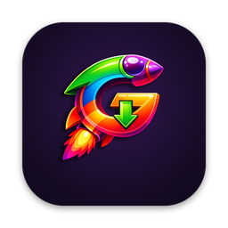
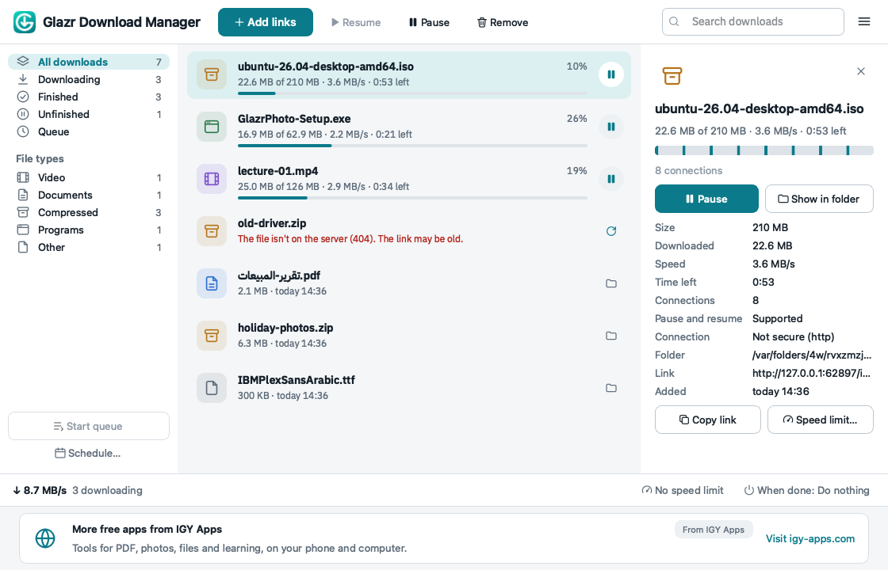
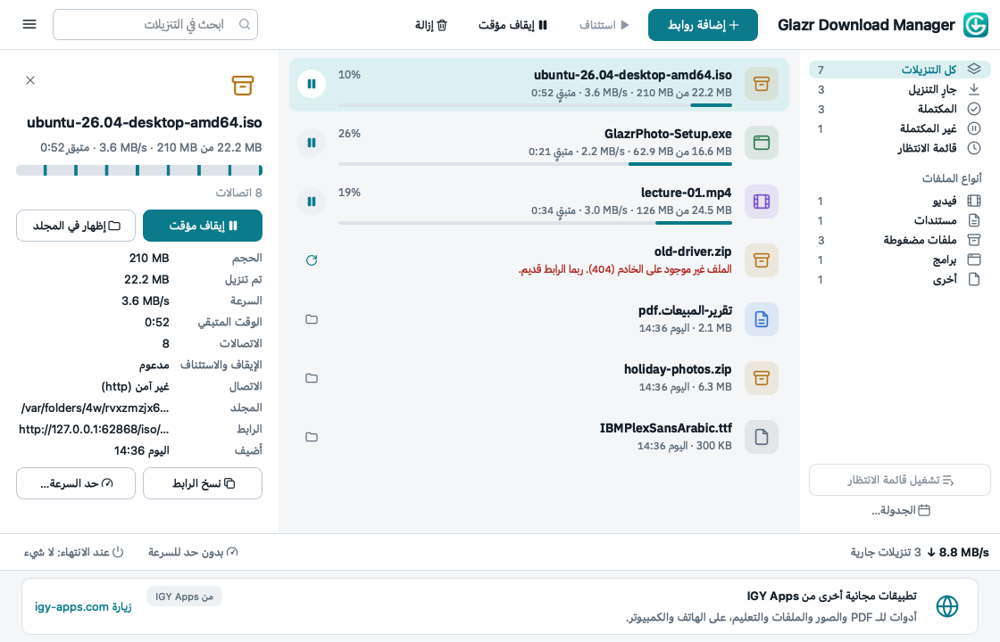

# Glazr Download Manager

Free download manager for **Windows 10/11** and **macOS** by [IGY Apps](https://igy-apps.com).
Faster downloads with several connections per file, pause and resume that survive restarts
and dropped connections, a queue with a schedule, and speed limits.

- Several connections per file, split while it downloads.
- Pause and resume any time, even after a restart or a power cut.
- A window for each download, with its progress, speed and a Pause button.
- An expired link? Give it a new one and the download continues where it stopped.
- Queue, schedule, speed limits; sleep or shut down when done.
- Browser extension for Chrome, Edge and Brave from the [Chrome Web Store](https://chromewebstore.google.com/detail/glazr-download-manager/enkamijjlfaljkflhjgnfnmacmpkpfgo); Firefox by hand.
- Arabic, English, French and German; light and dark.
- Free: no ads inside downloads, no bundled offers, no tracking.



## Download

| System | Where |
|---|---|
| macOS 12 or newer, Apple Silicon (M1 and later) | **[Releases](https://github.com/islammohy/glazr-download-manager/releases/latest)**: `Glazr-Download-Manager-<version>-macOS-arm64.dmg`, signed and notarized by Apple |
| Windows 10/11 (64-bit) | **[Microsoft Store](https://apps.microsoft.com/detail/9P4MPPR56N49)** |

Open the DMG and drag the app to Applications. Check the download against `SHA256SUMS.txt` in
the same release if you like: `shasum -a 256 <file>`.

This repository holds downloads only. The application's source code is not public.

## Browser extension

**Chrome, Edge and Brave:** add Glazr from the **[Chrome Web Store](https://chromewebstore.google.com/detail/glazr-download-manager/enkamijjlfaljkflhjgnfnmacmpkpfgo)**. The downloads you
start in the browser then go to the app, which must be installed. Edge asks once to allow
extensions from other stores. If you added the extension by hand before, remove that copy.

If Chrome says *Proceed with caution*: it shows this only with Enhanced protection on, for
extensions from developers new to the Chrome Web Store. Google reviewed and approved the
extension; choose **Continue to install**.

**Firefox:** add it by hand in a minute: Menu › Browser extension… in the app, then follow the
[guide with pictures](docs/EXTENSION.md).

## Command line and AI assistants

Menu › **Copy instructions for AI** copies a short text for ChatGPT, Claude, Codex or another
assistant that can run commands on your computer. It can then download the links you give it:

```
glazr-download download "https://example.com/file.zip" --json
```

On Windows the command is `glazr-download`; on a Mac it is the program inside the app (the copied
text has the exact path). The command line only downloads http and https links you give it, saves
only in the folder you name or your download folder, never overwrites, opens or runs a file, does
not download from streaming sites or get past sign-ins, and needs your yes for files over 2 GB.

## Safety

- Security certificates of websites are always checked; there is no way to turn that off.
- The app never opens or runs a downloaded file by itself.
- Downloaded files are marked as coming from the internet, so Windows and macOS still check
  programs before they run.
- The app downloads files that servers offer as downloads. It does not download video from
  streaming sites such as YouTube and does not bypass copy protection.

## Privacy

Your downloads stay on your computer. When online, the app downloads one banner and the
newest version number from igy-apps.com, sending only the app name, the system, the language
and where it was installed from. igy-apps.com keeps daily totals of these values and of banner
clicks, with no IP address and no device or user identifier. Full text: [PRIVACY.md](PRIVACY.md).

## Open-source parts

The app is built with Qt/PySide6 (LGPLv3), urllib3 (MIT), truststore (MIT), PySocks (BSD) and
the IBM Plex Sans Arabic font (OFL). Their licenses are in the app's `licenses` folder.

## Problems and ideas

Open an [issue](https://github.com/islammohy/glazr-download-manager/issues). Please don't
post private links or cookies.

---

<div dir="rtl">

# Glazr Download Manager بالعربية

مدير تنزيلات مجاني لـ **ويندوز 10/11** و**ماك** من [IGY Apps](https://igy-apps.com).
تنزيل أسرع بعدة اتصالات لكل ملف، وإيقاف واستئناف يصمدان أمام إعادة التشغيل وانقطاع
الاتصال، وقائمة انتظار مع جدولة، وحد للسرعة.

- عدة اتصالات لكل ملف، تُقسَّم أثناء التنزيل.
- إيقاف واستئناف في أي وقت، حتى بعد إعادة التشغيل أو انقطاع الكهرباء.
- نافذة لكل تنزيل فيها التقدّم والسرعة وزر الإيقاف المؤقت.
- انتهت صلاحية الرابط؟ أعطه رابطًا جديدًا ويكمل التنزيل من حيث توقف.
- قائمة انتظار، وجدولة، وحد للسرعة، وسكون أو إيقاف تشغيل عند الانتهاء.
- إضافة للمتصفح لكروم وإيدج وبريف من [Chrome Web Store](https://chromewebstore.google.com/detail/glazr-download-manager/enkamijjlfaljkflhjgnfnmacmpkpfgo)، ولفايرفوكس يدويًا.
- العربية والإنجليزية والفرنسية والألمانية؛ وضع فاتح وداكن.
- مجاني: بلا إعلانات داخل التنزيلات، بلا عروض مدمجة، بلا تتبع.

**التنزيل:** لماك (macOS 12 أو أحدث، معالجات Apple M1 وما بعدها) ملف `.dmg` موقّع ومعتمد من Apple في
صفحة [الإصدارات](https://github.com/islammohy/glazr-download-manager/releases/latest). لويندوز من
[Microsoft Store](https://apps.microsoft.com/detail/9P4MPPR56N49).

**إضافة المتصفح:** لكروم وإيدج وبريف أضف Glazr من **[Chrome Web Store](https://chromewebstore.google.com/detail/glazr-download-manager/enkamijjlfaljkflhjgnfnmacmpkpfgo)**، فتذهب
التنزيلات التي تبدأها في المتصفح إلى البرنامج (يجب أن يكون مثبّتًا). يطلب إيدج مرة واحدة السماح
بإضافات المتاجر الأخرى. إذا كنت أضفت الإضافة يدويًا من قبل، احذف تلك النسخة. إذا ظهرت رسالة
*Proceed with caution*: يعرضها كروم فقط لمن فعّل الحماية المحسّنة، مع إضافات المطوّرين الجدد في
المتجر. راجعت جوجل الإضافة ووافقت عليها؛ اختر **Continue to install**. لفايرفوكس تضيفها بنفسك في
دقيقة: القائمة › إضافة المتصفح… في البرنامج، ثم اتبع [الشرح بالصور](docs/EXTENSION.ar.md).

**سطر الأوامر ومساعدو الذكاء الاصطناعي:** من القائمة › **نسخ تعليمات للذكاء الاصطناعي** تُنسخ
تعليمات قصيرة لـ ChatGPT أو Claude أو Codex أو أي مساعد يستطيع تشغيل الأوامر على جهازك، فينزّل
الروابط التي تعطيها له فقط، ويحفظ في المجلد الذي تسمّيه أو في مجلد التنزيل، ولا يكتب فوق أي ملف
ولا يفتحه ولا يشغّله، ولا ينزّل من مواقع البث ولا يتجاوز تسجيل الدخول، ويسألك قبل الملفات الأكبر
من 2 جيجابايت.

**الأمان:** شهادات المواقع تُفحص دائمًا، والبرنامج لا يفتح أي ملف منزّل بنفسه، والملفات
المنزّلة تُعلَّم بأنها من الإنترنت فيفحصها النظام قبل تشغيلها. البرنامج لا ينزّل الفيديو من
مواقع البث مثل يوتيوب.

**الخصوصية:** تنزيلاتك تبقى على جهازك. عند الاتصال بالإنترنت يجلب البرنامج الشريط الذي في
أسفل النافذة ورقم أحدث إصدار فقط، ويرسل اسم البرنامج والنظام واللغة ومصدر التثبيت. يحتفظ
igy-apps.com بإجماليات يومية لهذه القيم ولنقرات الشريط، بلا عنوان IP وبلا معرّف للجهاز أو
للمستخدم. التفاصيل في [PRIVACY.md](PRIVACY.md).



</div>
