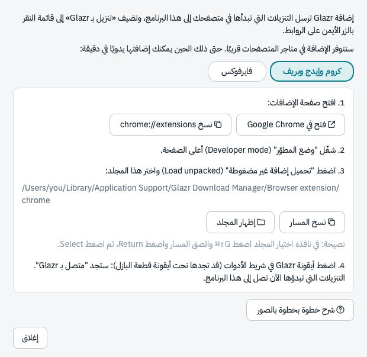
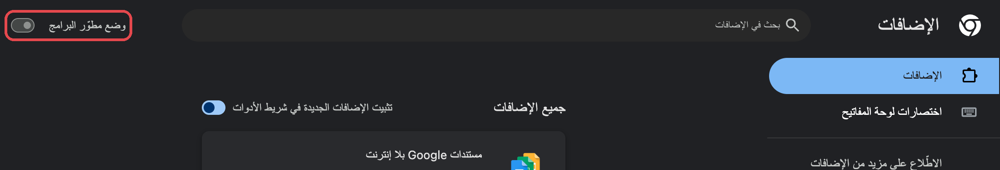
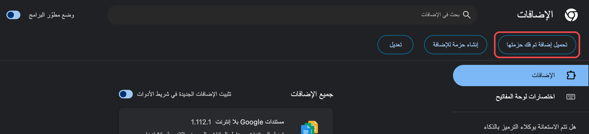
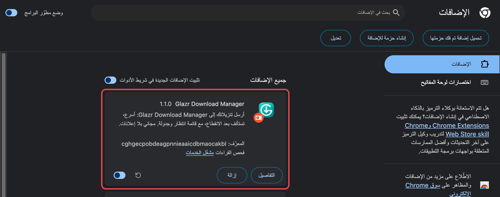
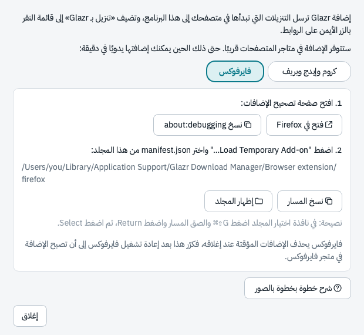

# إضافة Glazr إلى متصفحك

[English](EXTENSION.md)

ترسل الإضافة التنزيلات التي تبدؤها في متصفحك إلى Glazr Download Manager، وتضيف «تنزيل بـ Glazr»
إلى قائمة النقر بالزر الأيمن على الروابط.

**لكروم وإيدج وبريف: أضفها من [Chrome Web Store](https://chromewebstore.google.com/detail/glazr-download-manager/enkamijjlfaljkflhjgnfnmacmpkpfgo) بدلًا من ذلك**، فهو أسرع وتتحدّث
الإضافة وحدها. هذا الشرح لفايرفوكس، ولمن يريد إضافتها يدويًا في أي من هذه المتصفحات. يستغرق ذلك
دقيقة، وتفعله مرة واحدة (في فايرفوكس: بعد كل إعادة تشغيل).

ابدأ من البرنامج: **القائمة › إضافة المتصفح…** في النافذة كل ما تحتاجه: زر يفتح صفحة الإضافات في
متصفحك، والمجلد الذي تختاره مع زر ينسخ مساره.

## كروم وإيدج وبريف وفيفالدي

1. في البرنامج اضغط **فتح في Google Chrome** (أو Edge أو Brave أو Vivaldi). ويمكنك أيضًا كتابة
   العنوان بنفسك: `chrome://extensions` (في إيدج: `edge://extensions`، وفي بريف: `brave://extensions`).
2. شغّل **وضع مطوّر البرامج** (Developer mode) أعلى الصفحة.

   

3. اضغط **تحميل إضافة تم فك حزمتها** (Load unpacked).

   

4. اختر المجلد الذي يعرضه البرنامج. اضغط أولًا **نسخ المسار** في البرنامج، ثم في نافذة اختيار المجلد:
   - **ماك:** اضغط <kbd>⌘</kbd> <kbd>⇧</kbd> <kbd>G</kbd> والصق المسار واضغط Return، ثم اضغط
     **Select**.
   - **ويندوز:** اضغط على شريط العنوان في الأعلى والصق المسار واضغط Enter، ثم اضغط
     **Select Folder**.

   المجلد على ماك هو
   `~/Library/Application Support/Glazr Download Manager/Browser extension/chrome` وعلى ويندوز
   `%LOCALAPPDATA%\IGY Apps\Glazr Download Manager\Browser extension\chrome`. البرنامج يحدّثه
   بنفسه، فاتركه في مكانه.
5. تظهر Glazr Download Manager في القائمة:

   

6. اضغط أيقونة قطعة البازل في شريط أدوات المتصفح وثبّت Glazr. اضغط أيقونتها: ستجد **متصل بـ Glazr**
   (أو **جاهز** والبرنامج مغلق؛ يفتحه المتصفح بنفسه عندما تنزّل شيئًا). من الآن تذهب التنزيلات التي
   تبدؤها في هذا المتصفح إلى البرنامج.

## فايرفوكس

1. في البرنامج اضغط **فتح في Firefox**، أو اكتب `about:debugging#/runtime/this-firefox` في شريط
   العنوان.
2. اضغط **Load Temporary Add-on…** واختر `manifest.json` من مجلد `firefox` الذي يعرضه البرنامج
   (انسخ مساره من البرنامج؛ على ماك استخدم <kbd>⌘</kbd> <kbd>⇧</kbd> <kbd>G</kbd> في نافذة الملفات).
3. فايرفوكس يحذف الإضافات المؤقتة عند إغلاقه. كرّر هذا بعد إعادة تشغيل فايرفوكس إلى أن تصبح الإضافة
   في متجر فايرفوكس.

## إن لم تعمل

- **غير متصل:** افتح Glazr Download Manager مرة واحدة (يعرّف نفسه لكل متصفح يجده عند تشغيله)، ثم
  أغلق المتصفح وافتحه من جديد.
- **نافذة المجلدات على ماك لا تعرض Library:** استخدم <kbd>⌘</kbd> <kbd>⇧</kbd> <kbd>G</kbd> والصق
  المسار كما في الخطوة 4.
- **ما زالت التنزيلات تبقى في المتصفح:** اضغط أيقونة Glazr وتأكد أن **إرسال التنزيلات إلى Glazr**
  مفعّل.
- أسئلة: [افتح مشكلة (issue)](https://github.com/islammohy/glazr-download-manager/issues).

[العودة إلى الصفحة الرئيسية](../README.md)

