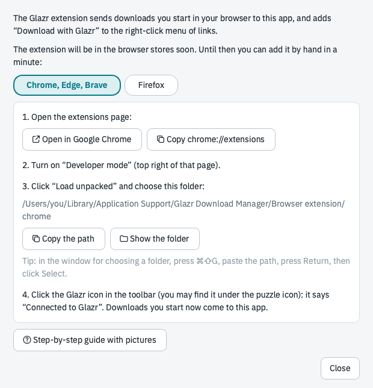
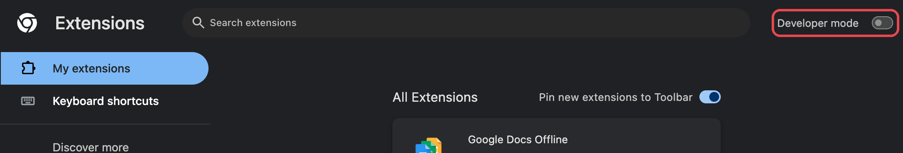
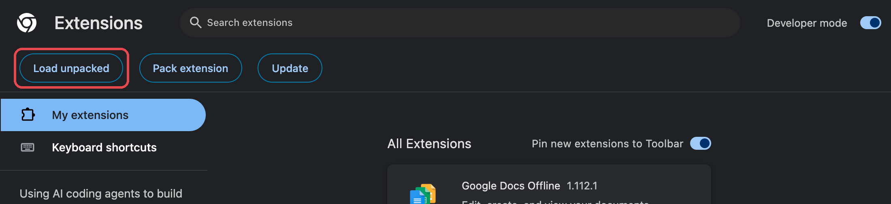
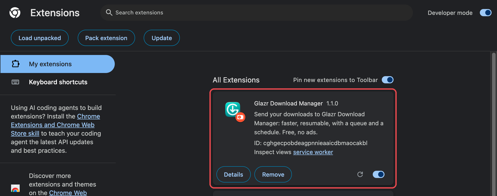
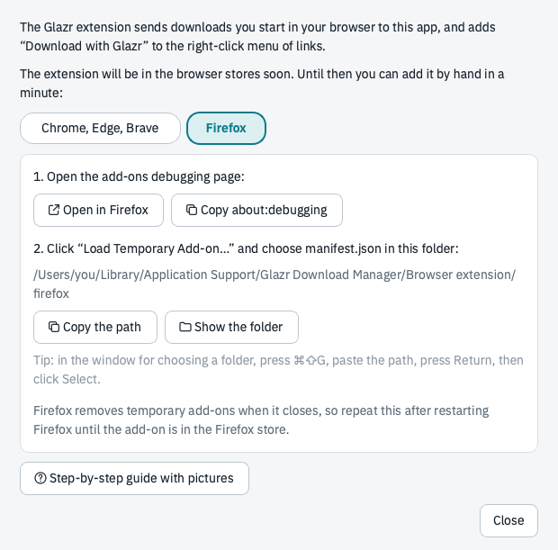

# Add the Glazr extension to your browser

[العربية](EXTENSION.ar.md)

The extension sends the downloads you start in your browser to Glazr Download Manager, and adds
"Download with Glazr" to the right-click menu of links. Until it is in the Chrome, Edge and Firefox
stores, you add it by hand. It takes a minute, and you do it once (Firefox: after each restart).

Start in the app: **Menu › Browser extension…** The window has everything you need: a button that
opens your browser's extensions page, and the folder to choose, with a button that copies its path.

## Chrome, Edge, Brave, Vivaldi

1. In the app, press **Open in Google Chrome** (or Edge, Brave, Vivaldi). You can also type the
   address yourself: `chrome://extensions` (Edge: `edge://extensions`, Brave: `brave://extensions`).
2. Turn on **Developer mode**, at the top right of the page.

   

3. Click **Load unpacked**.

   

4. Choose the folder the app shows. Press **Copy the path** in the app first, then in the window
   for choosing a folder:
   - **Mac:** press <kbd>⌘</kbd> <kbd>⇧</kbd> <kbd>G</kbd>, paste, press Return, then click
     **Select**.
   - **Windows:** click the address bar at the top, paste, press Enter, then click
     **Select Folder**.

   The folder is
   `~/Library/Application Support/Glazr Download Manager/Browser extension/chrome` on a Mac and
   `%LOCALAPPDATA%\IGY Apps\Glazr Download Manager\Browser extension\chrome` on Windows. The app
   keeps it up to date, so leave it where it is.
5. Glazr Download Manager appears in the list:

   

6. Click the puzzle icon in the browser's toolbar and pin Glazr. Click its icon: it says
   **Connected to Glazr** (or **Ready** while the app is closed; the browser starts it when you
   download something). From now on, downloads you start in this browser go to the app.

## Firefox

1. In the app, press **Open in Firefox**, or type `about:debugging#/runtime/this-firefox` in the
   address bar.
2. Click **Load Temporary Add-on…** and choose `manifest.json` in the `firefox` folder the app
   shows (copy its path in the app; on a Mac, <kbd>⌘</kbd> <kbd>⇧</kbd> <kbd>G</kbd> in the file
   window).
3. Firefox removes temporary add-ons when it quits. Do this again after restarting Firefox, until
   the add-on is in the Firefox store.

## If it does not work

- **Not connected:** open Glazr Download Manager once (it introduces itself to every browser it
  finds when it starts), then quit and reopen the browser.
- **The Mac folder window does not show Library:** use <kbd>⌘</kbd> <kbd>⇧</kbd> <kbd>G</kbd> and
  paste the path, as in step 4.
- **Downloads still stay in the browser:** click the Glazr icon and check that **Send downloads to
  Glazr** is on.
- Questions: [open an issue](https://github.com/islammohy/glazr-download-manager/issues).

[Back to the main page](../README.md)
